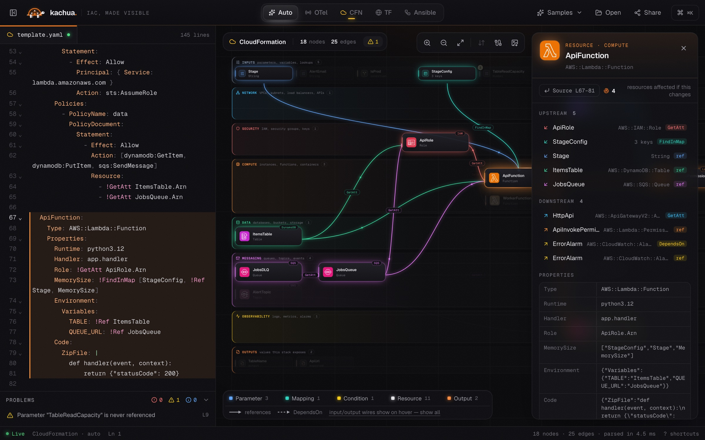
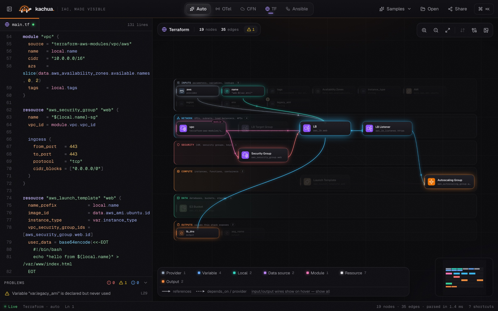
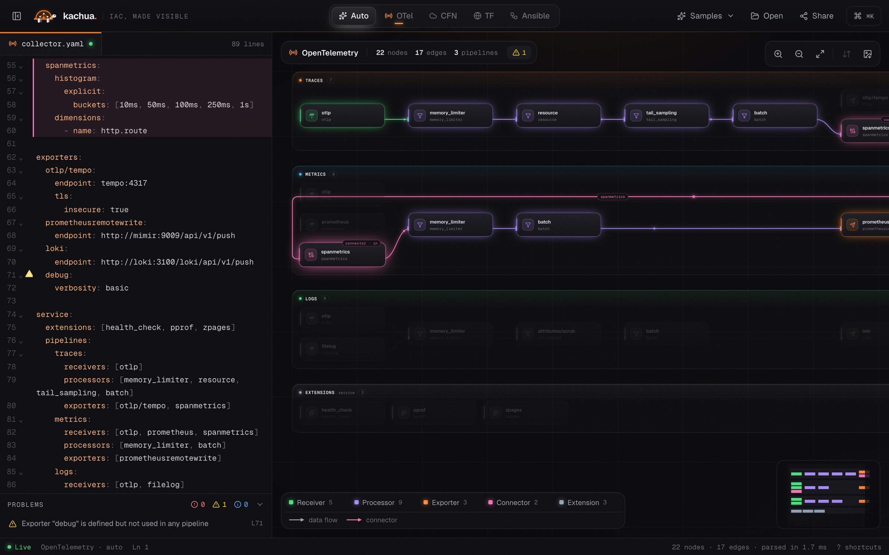
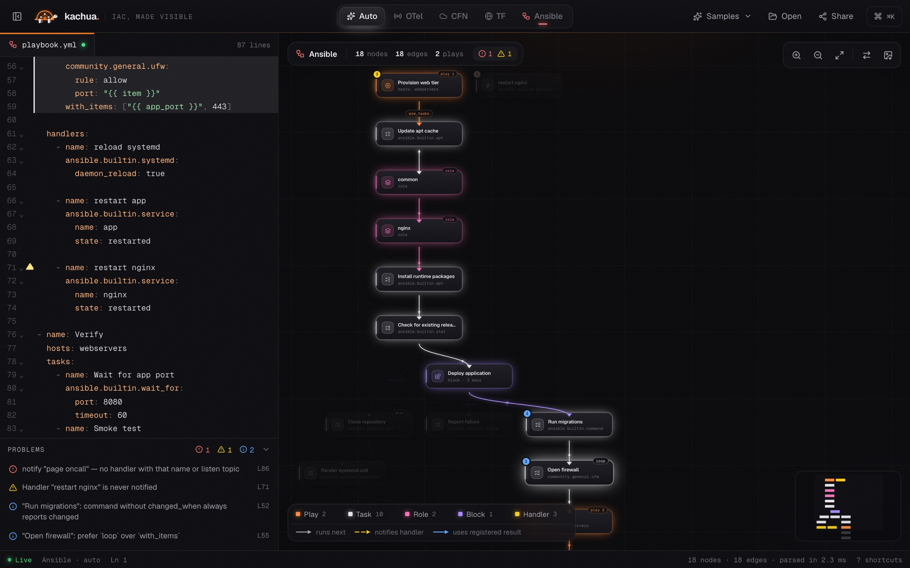
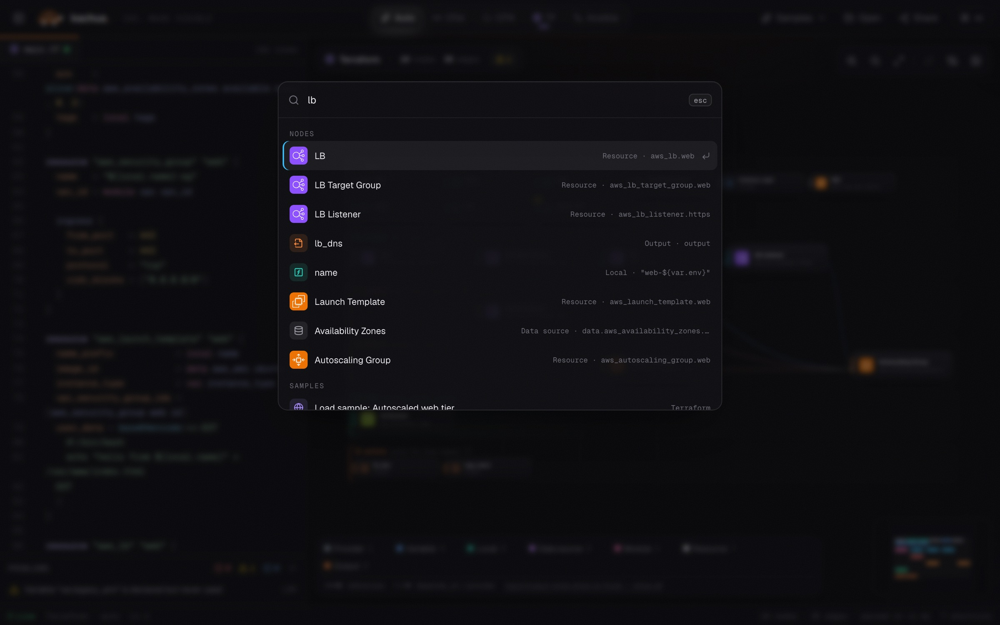

<p align="center">
  
</p>

<h1 align="center">Kachua</h1>

<p align="center">
  <strong>Infrastructure-as-code, made visible.</strong><br />
  Paste Terraform, CloudFormation, Ansible or OpenTelemetry Collector config and get a live,
  explorable architecture diagram with dependency tracing, linting and blast-radius analysis.
</p>

<p align="center">
  
</p>

---

## Overview

Configuration files describe systems, but they are hard to read as systems. Kachua parses your
config as you type and draws it as a diagram you can explore. You can see what depends on what,
what breaks if something changes, and what is wired incorrectly.

Everything runs in the browser. There is no backend, no account and no telemetry, and your
configuration never leaves the page.

*Kachua* (कछुआ) is Hindi for tortoise: a graph on its back, steady through any config.

## Highlights

- **Live graph.** The diagram updates as you type. On a syntax error the last valid graph stays on screen and the error points to the exact line.
- **Architecture view for infrastructure.** Resources are grouped into labelled lanes (Network, Security, Compute, Data, Messaging, Observability). Left to right reads as dependency order, and AWS resources show their official architecture icons.
- **Trace anything.** Hover a node to light up everything upstream and downstream. Click it to see its properties, its neighbours and its blast radius.
- **Editor ⇄ diagram linking.** Selecting a node highlights its source. Moving the cursor in the editor highlights the node under it.
- **Built-in linting.** Undefined references, unused inputs, dependency cycles, missing handlers and ordering hints show inline, on the node and in the Problems panel.
- **Share and export.** Share links carry the whole config in the URL. You can also export a high-resolution PNG or a Mermaid flowchart.
- **Keyboard-first.** A command palette (`⌘K`) jumps to any node, runs actions and loads samples.

## Supported formats

| Format | What you see | What it checks |
|---|---|---|
| **Terraform** (HCL) | Resources, data sources, modules, variables, locals, providers and outputs. References come from expressions, `${}` interpolation and heredocs. | Undeclared references, unused variables and locals, cycles, duplicate declarations |
| **CloudFormation** / SAM (YAML or JSON) | Resources, parameters, mappings, conditions and outputs, via `Ref`, `GetAtt`, `Sub`, `FindInMap`, `If`, `DependsOn` and `Condition` in short and long form | Unresolved references, unused parameters, circular dependencies |
| **Ansible** | Plays → pre-tasks → roles → tasks, including blocks with `rescue`/`always`. Shows notify → handler edges and `register` → `when` data flow. | Unknown or never-notified handlers, `command`/`shell` without `changed_when`, legacy `with_*` loops |
| **OpenTelemetry Collector** | Each pipeline as a lane (receivers → processors → exporters), with connectors bridging pipelines | Undefined or unused components, missing receivers or exporters, processor ordering |

The format is detected automatically. You can also choose it in the top bar.

## Screenshots

<table>
  <tr>
    <td width="50%"><br /><sub><b>Terraform.</b> Hovering a load balancer traces its dependencies and outputs.</sub></td>
    <td width="50%"><br /><sub><b>OpenTelemetry.</b> Pipelines as lanes, with a connector feeding traces into metrics.</sub></td>
  </tr>
  <tr>
    <td width="50%"><br /><sub><b>Ansible.</b> Execution order, rescue paths and handlers, with lint results alongside.</sub></td>
    <td width="50%"><br /><sub><b>Command palette.</b> Jump to any node or action from the keyboard.</sub></td>
  </tr>
</table>

## Getting started

**Requirements:** Node.js 20 or later and pnpm 9 or later.

```bash
pnpm install
pnpm dev            # http://localhost:5791
```

Paste a config into the editor, drop a file anywhere on the page, or open one of the samples.

### Scripts

| Command | Description |
|---|---|
| `pnpm dev` | Start the development server on port 5791 |
| `pnpm build` | Type-check and build the production bundle into `dist/` |
| `pnpm preview` | Serve the production build on port 5792 |
| `pnpm test` | Run the unit tests (parsers, icon mapping) |
| `pnpm test:e2e` | Build, serve and run the end-to-end browser suite |
| `pnpm typecheck` | Type-check without emitting |

### Configuration

Copy `.env.example` to `.env` and set the public origin before deploying:

```bash
VITE_SITE_URL=https://kachua.example.com
```

It is used for the canonical, Open Graph and structured-data URLs, and for `sitemap.xml`, which
is generated at build time. When it is unset, the build falls back to site-relative URLs and skips
the sitemap.

### Deployment

`pnpm build` produces a fully static site in `dist/` that you can host on any static file server
or CDN. No server-side runtime is required.

## Keyboard shortcuts

| Keys | Action |
|---|---|
| `⌘K` / `Ctrl K` | Command palette: jump to a node, run an action, load a sample |
| `/` | Search nodes |
| `⌘S` / `Ctrl S` | Copy a share link |
| `⌘\` or `E` | Toggle the editor |
| `F` | Fit the graph to the screen |
| `W` | Show all input/output wiring (Terraform, CloudFormation) |
| `L` | Flip layout direction (Ansible) |
| `Esc` | Clear the selection |
| `?` | Show all shortcuts |

## How it works

```
source text ──► parser ──► graph model ──► layout ──► interactive canvas
                (per format)  nodes, edges,   lanes or      inspector, lineage,
                              diagnostics     layered DAG   editor linking
```

- **Parsers** (`src/parsers`) keep source positions so every node, edge and diagnostic maps back to a line. YAML formats use a position-preserving YAML parser. Terraform uses a purpose-built HCL reader that tracks blocks, attributes, interpolations and heredocs without evaluating expressions.
- **Graph model** (`src/core/types.ts`) is format-agnostic: nodes, typed edges (`flow`, `ref`, `depends`, `notify`, `bridge`), lanes and diagnostics.
- **Layout** (`src/layout`) draws OpenTelemetry pipelines and infrastructure as lanes, with columns ranked by dependency depth. Ansible uses a layered DAG.

```
src/
├── app/          # bootstrap, live parsing, sharing, keyboard shortcuts
├── components/   # canvas, editor, inspector, command palette, chrome
├── core/         # graph model, store, lineage, icon mapping, naming
├── layout/       # lane, architecture and layered layouts
├── parsers/      # OpenTelemetry, CloudFormation, Terraform (HCL), Ansible
└── samples/      # example configs for each format
tests/e2e/        # end-to-end browser tests
build/            # build-time SEO plugin (canonical URLs, robots, sitemap)
```

## Testing

```bash
pnpm test        # unit tests
pnpm test:e2e    # end-to-end browser tests
```

The unit tests cover every parser, format detection, reference resolution, linting and the
resource-to-icon mapping. The end-to-end suite drives the built app in a real browser. It covers
live editing, error recovery, editor ⇄ diagram linking, lineage, the command palette, share links,
file open and drop, export and the mobile layout. Any console error fails the run.

## Privacy

Kachua makes no network requests with your data. Parsing, layout and rendering all happen
locally. A share link stores the configuration compressed in the URL fragment (`#…`), and browsers
never send the fragment to a server.
